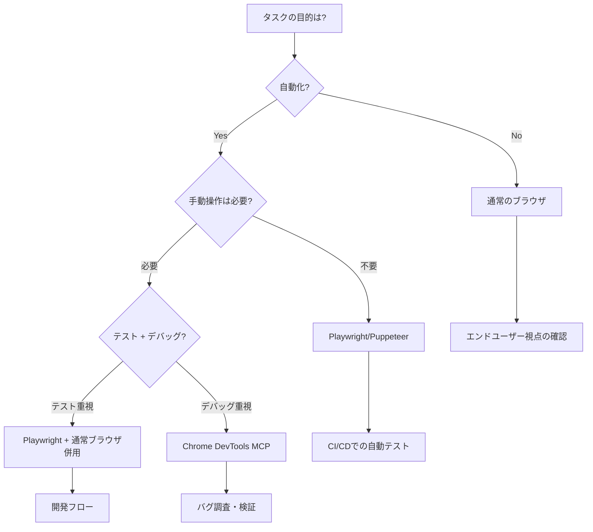

# ブラウザ自動化テストの知恵：ツール選択と使い分け

## 概要

このドキュメントは、order-1タスクでPlaywright MCPとChrome DevTools MCPを使用した経験から、**ブラウザ自動化ツールの特性理解**と**適切な使い分け**の知恵をまとめたものです。

---

## 1. ツールの本質を理解する

### 1.1 「自動化ツール」には2つの顔がある

**テスト自動化ツール（例：Playwright、Puppeteer）:**
- **目的**: 自動テストの実行、CI/CDでの品質保証
- **特徴**: プログラムによる厳密な制御
- **制約**: ユーザー操作を抑制・インターセプトする

**デバッグ・開発支援ツール（例：Chrome DevTools、Browser Extensions）:**
- **目的**: 手動デバッグ、開発時の検証
- **特徴**: 手動操作とツール操作の共存
- **制約**: 自動化機能は限定的

**思考のポイント：**

> 💡 **「自動化できる」≠「手動操作もできる」**
> 
> テスト自動化ツールは、ユーザーの手動操作を「邪魔」とみなして抑制することがある。
> これは仕様であり、バグではない。

---

### 1.2 今回の実例：Playwright vs Chrome DevTools

| 観点 | Playwright MCP | Chrome DevTools MCP |
|------|---------------|---------------------|
| **設計思想** | テスト自動化 | デバッグ・検証 |
| **ファイル選択** | 自動インターセプト（手動操作不可） | 手動操作可能 |
| **適用場面** | CIでの自動テスト | 開発時の動作確認 |
| **学習コスト** | 高（API理解が必要） | 低（直感的） |
| **柔軟性** | 低（制約が多い） | 高（自由度が高い） |

**判断基準：**

```
目的は何か？
  ↓
  ├─ 自動テスト（CI/CD） → Playwright/Puppeteer
  ├─ 手動で動作確認      → Chrome DevTools/通常ブラウザ
  └─ 両方必要           → 使い分ける
```

---

## 2. ツール選択の判断フローチャート

### 2.1 シーン別の最適ツール



### 2.2 「動かない」ときの切り分け

**ステップ1: 通常のブラウザで確認**

```
通常のChromeで動作するか？
  ↓
  ├─ Yes → ツール固有の問題
  └─ No  → コード実装の問題
```

**ステップ2: ツール固有の問題なら**

```
どのツールで発生？
  ↓
  ├─ Playwright     → 仕様・制約を調査
  ├─ Chrome DevTools → 設定・権限を確認
  └─ すべて         → ブラウザAPI/互換性の問題
```

**ステップ3: 対処方針**

```
仕様による制約か？
  ↓
  ├─ Yes → ツールを使い分ける（コード変更不要）
  └─ No  → コード修正を検討
```

---

## 3. Playwright MCPの特性と落とし穴

### 3.1 Playwrightが「できること」「できないこと」

**できること（自動化に最適）:**
- ✅ ボタンクリック、フォーム入力の自動化
- ✅ スクリーンショット、動画録画
- ✅ ネットワークリクエストの監視・モック
- ✅ 複数ブラウザでの並列テスト
- ✅ ファイルアップロードの自動化（`browser_file_upload`ツール）

**できないこと（制約）:**
- ❌ ユーザーによる手動ファイル選択
- ❌ 手動クリックでのダイアログ表示
- ❌ ブラウザのネイティブUIとの自然な対話

### 3.2 ファイル選択ダイアログのインターセプト

**Playwrightの挙動：**

```javascript
// 内部的に以下が有効になっている
page.setInterceptFileChooserDialog(true);

// これにより：
// - showDirectoryPicker() は呼ばれるが、ダイアログは表示されない
// - input.click() も同様
// - 代わりに FileChooser イベントが発火
```

**なぜインターセプトするのか？**

> 📚 **設計思想：テスト自動化の確実性を優先**
> 
> ユーザーの手動操作を待つと：
> - テストが止まる
> - CIで実行できない
> - 結果が不安定になる
> 
> だからPlaywrightは「ダイアログを出さず、プログラムで制御する」設計を選んだ。

**教訓：**

> ⚠️ **Playwrightでファイル選択をテストするには、専用のAPIを使う**
> 
> - `page.on('filechooser', ...)` でイベントをキャッチ
> - `fileChooser.setFiles(...)` でファイルを設定
> - **手動クリックは想定されていない**

---

### 3.3 経験的な回避策

**間違ったアプローチ（今回やってしまった）:**

```typescript
// ❌ Playwright用にコードを変更
async selectFolder() {
  // showDirectoryPicker を捨てて input要素に変更
  const input = document.createElement('input');
  input.webkitdirectory = true;
  input.click(); // ← これもPlaywrightでは無意味
}
```

**正しいアプローチ：**

```typescript
// ✅ コードはそのまま、ツールを使い分ける

// 通常のブラウザ / Chrome DevTools MCP用
async selectFolder() {
  return await window.showDirectoryPicker(); // ← 標準APIでOK
}

// Playwright用の自動テストは別途実装
// tests/e2e/folder-upload.spec.ts
test('フォルダアップロード', async ({ page }) => {
  const [fileChooser] = await Promise.all([
    page.waitForEvent('filechooser'),
    page.click('button:has-text("フォルダを開く")')
  ]);
  await fileChooser.setFiles([...]);
});
```

**教訓：**

> 🎯 **ツールの制約に合わせてコードを変更するのではなく、ツールを使い分ける**
> 
> - 本番コード: 標準API（showDirectoryPicker）
> - 自動テスト: Playwright専用API
> - 手動確認: 通常ブラウザ or Chrome DevTools MCP

---

## 4. Chrome DevTools MCPの特性

### 4.1 DevToolsの利点

**手動操作との共存:**
- ✅ ボタンをクリックすると、実際にダイアログが表示される
- ✅ 開発者が手動で操作できる
- ✅ 自然なユーザー体験を確認できる

**柔軟なデバッグ:**
- ✅ コンソールログをリアルタイムで確認
- ✅ ネットワークタブでリクエスト監視
- ✅ Elements/SourcesタブでDOM/コード確認
- ✅ スナップショットで状態確認

### 4.2 DevToolsが適している場面

| シーン | 理由 |
|--------|------|
| **バグ調査** | 実際の動作を目で見て確認できる |
| **UI/UXの確認** | ユーザー視点での操作感を体験 |
| **プロトタイプ検証** | 素早く動作確認 |
| **ブラウザAPIのテスト** | ネイティブAPIの挙動を確認 |

### 4.3 DevToolsの制約

**自動化機能の限界:**
- ❌ CI/CDでの実行は困難
- ❌ 並列実行は難しい
- ❌ 複雑なシナリオテストには不向き

**判断基準：**

```
手動確認が必要か？
  ↓
  ├─ Yes → Chrome DevTools MCP
  └─ No  → Playwright（自動化優先）
```

---

## 5. ツールの使い分けマトリックス

### 5.1 タスク別の推奨ツール

| タスク | 通常ブラウザ | Chrome DevTools | Playwright | 理由 |
|--------|-------------|----------------|------------|------|
| **初回動作確認** | ⭐⭐⭐ | ⭐⭐⭐ | ⭐ | エンドユーザー視点で確認 |
| **バグ調査** | ⭐⭐ | ⭐⭐⭐ | ⭐ | DevToolsで詳細確認 |
| **ファイル操作の手動テスト** | ⭐⭐⭐ | ⭐⭐⭐ | ❌ | 手動操作が必要 |
| **自動回帰テスト** | ❌ | ❌ | ⭐⭐⭐ | CI/CDでの自動実行 |
| **スクリーンショット比較** | ⭐ | ⭐⭐ | ⭐⭐⭐ | Playwrightが最適 |
| **APIモック** | ❌ | ⭐ | ⭐⭐⭐ | Playwrightが強力 |

### 5.2 開発フローでの使い分け

```
開発の流れ：
  ↓
1. 機能実装
  ↓
2. 通常ブラウザで動作確認 ← まずここ！
  ↓
3. Chrome DevTools MCPでデバッグ ← 問題があれば
  ↓
4. Playwrightで自動テスト作成 ← 安定したら
  ↓
5. CI/CDで自動実行
```

---

## 6. ケーススタディ：order-1タスク

### 問題
Playwright MCPで「フォルダを開く」ボタンが動作しない

### 失敗した判断プロセス

```
1. Playwright MCPで動作しない
   ↓
2. コードに問題があると推測 ← ❌ 早計
   ↓
3. showDirectoryPicker → input要素に書き換え ← ❌ 大規模変更
   ↓
4. Chrome DevTools MCPで元のコードが動作
   ↓
5. 全ての変更をロールバック ← 😭 時間のロス
```

### 正しい判断プロセス（学んだこと）

```
1. Playwright MCPで動作しない
   ↓
2. 通常のChromeブラウザで確認 ← ✅ まずここ！
   ↓
3. 動作する → Playwright固有の問題と特定
   ↓
4. Playwrightのドキュメント確認
   ↓
5. ファイルダイアログのインターセプトが仕様と理解
   ↓
6. Chrome DevTools MCPに切り替え ← ✅ ツールの使い分け
   ↓
7. コード変更不要 ← ✅ 時間節約！
```

### 得られた知恵

**技術的知恵:**
- Playwright = テスト自動化専用、手動操作は想定外
- Chrome DevTools = デバッグ用、手動操作OK
- コードはツールに合わせて変えない、ツールを使い分ける

**判断の知恵:**
- まず通常環境で動作確認
- ツールの特性を理解してから使う
- 目的に応じてツールを選択

**時間の知恵:**
- 正しいアプローチ: 15分
- 間違ったアプローチ: 2時間
- **8倍の差！**

---

## 7. ツール選択の賢者の心得

### 7つの教訓

1. **目的を明確にする**
   - 自動テスト？ 手動確認？ デバッグ？

2. **ツールの設計思想を理解する**
   - テスト用とデバッグ用は別物

3. **まず通常環境で確認**
   - ツールの制約に惑わされない

4. **コードはツールに合わせない**
   - 標準APIを使い、ツールを使い分ける

5. **ドキュメントを読む**
   - 「できること」「できないこと」を把握

6. **適材適所**
   - それぞれの強みを活かす

7. **振り返りを忘れずに**
   - ツール選択の失敗から学ぶ

---

## 8. 実践的なチェックリスト

### プロジェクト開始時

- [ ] 自動テストが必要か？
- [ ] 手動確認の頻度は？
- [ ] CI/CDで実行するか？
- [ ] どのツールを主に使うか決める

### 機能実装時

- [ ] まず通常のブラウザで動作確認
- [ ] 問題があればChrome DevTools MCPでデバッグ
- [ ] 安定したらPlaywrightで自動テスト作成

### 問題発生時

- [ ] どの環境で発生？（通常/DevTools/Playwright）
- [ ] ツール固有の制約か？
- [ ] ドキュメント・GitHubで確認
- [ ] ツールを切り替えて検証

---

## 9. 参考資料

### 公式ドキュメント
- [Playwright Documentation](https://playwright.dev/)
- [Chrome DevTools Protocol](https://chromedevtools.github.io/devtools-protocol/)
- [File System Access API - MDN](https://developer.mozilla.org/en-US/docs/Web/API/File_System_Access_API)

### 関連Issue
- [Playwright #412: File chooser interception](https://github.com/microsoft/playwright/issues/412)
- [Playwright #1950: Allow manual interaction](https://github.com/microsoft/playwright/issues/1950)

### 比較記事
- Playwright vs Puppeteer vs Selenium
- Browser automation tools comparison

---

**作成日**: 2025年11月6日  
**元タスク**: order-1.md  
**関連ドキュメント**: 
- `docs/reflectors/order-1-reflect.md`
- `docs/guidelines/browser-automation-testing.md`
- `docs/wisdom/debugging-wisdom.md`
