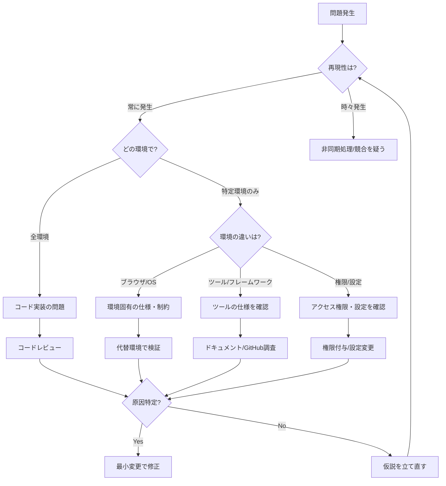

# デバッグの知恵：思考プロセスと判断基準

## 概要

このドキュメントは、order-1タスクの経験から抽出した**デバッグにおける思考プロセス**と**判断基準**をまとめたものです。単なる手順ではなく、「なぜそう考えるか」「どう判断するか」という経験知を記録します。

---

## 1. 問題の本質を見極める思考プロセス

### 1.1 症状から原因を推理する

**今回の実例：**
- **症状**: 「フォルダを開く」ボタンをクリックしてもダイアログが表示されない
- **最初の仮説**: コード実装の問題
- **実際の原因**: Playwright MCPの仕様（ファイル選択ダイアログを自動インターセプト）

**思考プロセス:**

```
症状を観察
  ↓
「何が期待と違うか」を明確化
  ↓
「どこで期待と実態が乖離しているか」を特定
  ↓
環境要因 vs コード要因 の切り分け
  ↓
最小の変更で検証
```

**判断基準：**

| 状況 | 疑うべき要因 | 理由 |
|------|--------------|------|
| 通常のブラウザで動作する | 環境固有の問題 | コードロジックは正しい可能性が高い |
| すべての環境で動作しない | コード実装の問題 | ロジック自体に誤りがある |
| 特定の操作でのみ失敗 | 状態管理の問題 | 条件分岐やライフサイクルに注目 |
| ランダムに失敗 | 非同期処理の競合 | Promise、タイミング、リソース競合を疑う |

**経験則：**

> 💡 **「動くはずなのに動かない」は、たいてい環境・前提条件の違いが原因**
> 
> コードレビューで正しく見えるなら、実行環境の差異（ブラウザ、権限、ネットワーク、ツールの仕様）を疑うべき。

---

### 1.2 失敗から学ぶ：今回の大きな過ち

**やってしまったこと：**

Playwright MCPでダイアログが開かないという症状に対して、**コード実装を大幅に変更**してしまった。

- `showDirectoryPicker()` → `<input webkitdirectory>` への全面書き換え
- 複雑な擬似ディレクトリハンドルの実装
- テストコードの修正

**なぜ失敗だったか：**

1. **原因の切り分けが不十分だった**
   - 通常のブラウザで動作確認していなかった
   - Playwright固有の問題という仮説を早期に検証しなかった

2. **最小変更の原則を守らなかった**
   - いきなり大規模な実装変更に走った
   - 元のコードの問題点を特定する前に書き換えた

3. **環境の特性を理解していなかった**
   - Playwright MCPはテスト自動化ツールであり、手動操作を前提としていない
   - Chrome DevTools MCPなど別のツールで試すべきだった

**正しいアプローチ：**

```
1. 通常のChromeブラウザで動作確認 ← これを最初にすべきだった！
   ↓
2. 動作する → Playwright MCPの問題と特定
   ↓
3. Playwrightのドキュメント・GitHubで仕様確認
   ↓
4. 代替ツール（Chrome DevTools MCP）で検証
   ↓
5. コード変更は不要と判断
```

**教訓：**

> ⚠️ **環境固有の問題を疑うときは、複数の環境で動作確認してから実装を変更する**
> 
> 特に、自動化ツール（Playwright、Puppeteer等）は手動操作と挙動が異なることが多い。

---

## 2. デバッグの判断フローチャート

### 2.1 問題発生時の意思決定ツリー



### 2.2 実装変更の判断基準

**変更すべき状況：**

- ✅ コードロジックに明確な誤りがある
- ✅ すべての環境で同じ問題が発生する
- ✅ テストが失敗している
- ✅ アーキテクチャ設計に問題がある

**変更すべきでない状況：**

- ❌ 特定の環境でのみ問題が発生する
- ❌ 通常の使用環境では正常に動作する
- ❌ ツール固有の制約・仕様による問題
- ❌ 原因が特定できていない

**判断の指針：**

> 🎯 **「最小変更の原則」— 問題の原因が特定できるまで、コードを変更しない**
> 
> 変更は必ず原因特定後に、影響範囲を最小限にして行う。

---

## 3. 環境の違いを見抜く経験則

### 3.1 ブラウザ自動化ツールの落とし穴

**Playwright MCP での学び：**

| 症状 | Playwrightの挙動 | 理由 |
|------|------------------|------|
| ファイル選択ダイアログが開かない | `Page.setInterceptFileChooserDialog()` で自動インターセプト | テスト自動化のための仕様 |
| 手動クリックが効かない | イベントは発火するがUIは表示されない | プログラムによる制御を優先 |
| `input.click()` のログは出る | JavaScriptは実行される | ただしブラウザのネイティブUIは抑制 |

**Chrome DevTools MCP での学び：**

| 症状 | Chrome DevToolsの挙動 | 理由 |
|------|----------------------|------|
| ファイル選択ダイアログが開く | ネイティブダイアログを許可 | DevToolsプロトコル経由で制御が緩い |
| 手動操作とツール操作の両立 | 両方をサポート | デバッグ用途のため柔軟 |

**経験則：**

> 💡 **自動化ツールは「テスト用」と「デバッグ用」で特性が異なる**
> 
> - **Playwright/Puppeteer**: テスト自動化に特化、ユーザー操作を厳密に制御
> - **Chrome DevTools**: デバッグ・検証用、手動操作も許容
> 
> 目的に応じて使い分ける。

---

### 3.2 環境差異のチェックリスト

問題が特定環境でのみ発生する場合、以下を確認：

**1. ブラウザ環境:**
- [ ] 通常のブラウザで動作するか？
- [ ] 異なるブラウザ（Chrome/Firefox/Safari）で動作するか？
- [ ] プライベートモード/シークレットモードで動作するか？

**2. 自動化ツール:**
- [ ] ツールのバージョンは？
- [ ] ツールのドキュメントで既知の制約は？
- [ ] GitHubのIssueで同様の報告は？
- [ ] 代替ツールで動作するか？

**3. API・仕様:**
- [ ] 使用しているAPIはすべてのブラウザでサポートされているか？
- [ ] 実験的機能（Experimental API）を使っていないか？
- [ ] Polyfillやフォールバックが必要か？

**4. 権限・設定:**
- [ ] 必要な権限（ファイルアクセス、カメラ、位置情報等）は付与されているか？
- [ ] ブラウザの設定（ポップアップブロック、Cookie等）は適切か？
- [ ] セキュリティポリシー（CSP、CORS等）に抵触していないか？

---

## 4. デバッグの経験的パターン

### 4.1 「動かない」の分類と対処

| パターン | 典型的な原因 | 対処法 |
|---------|-------------|--------|
| **完全に動かない** | 致命的エラー、API未サポート | コンソールエラー確認 |
| **時々動かない** | 非同期処理、競合状態 | タイミング・Promise処理を見直す |
| **特定条件で動かない** | 条件分岐、状態管理の誤り | 該当条件のテストケース追加 |
| **特定環境で動かない** | 環境依存の仕様・制約 | 環境差異を調査、代替実装検討 |

### 4.2 今回のケースの分類

**パターン:** 特定環境で動かない（Playwright MCP）

**原因:** 環境依存の仕様（ファイルダイアログのインターセプト）

**誤った対処:** コード実装を変更

**正しい対処:** 
1. 環境差異を理解する
2. 代替環境（Chrome DevTools MCP）で検証
3. コードは変更不要と判断
4. ツールの使い分けを明確化

---

## 5. 振り返りと改善サイクル

### 5.1 今回の反省点

1. **環境の特性理解が不足していた**
   - Playwright MCPの仕様を事前に調査すべきだった
   - 自動化ツールの「できること/できないこと」を把握していなかった

2. **検証の順序が間違っていた**
   - 最初に通常のブラウザで動作確認すべきだった
   - 代替環境での検証を後回しにした

3. **最小変更の原則を守らなかった**
   - 原因不明のまま大規模な実装変更に着手
   - 元のコードに問題がないかもしれない可能性を考慮しなかった

### 5.2 次回への教訓

**Do（すべきこと）:**

- ✅ 問題発生時は、まず通常の使用環境で動作確認
- ✅ 環境固有の問題を疑ったら、ツールのドキュメント・仕様を確認
- ✅ 複数の環境で検証してから、コード変更の要否を判断
- ✅ 最小変更の原則を徹底する

**Don't（すべきでないこと）:**

- ❌ 原因不明のまま大規模な実装変更
- ❌ 環境差異の調査を怠る
- ❌ テストツールの制約を実装で回避しようとする

**経験則：**

> 🎓 **デバッグは探偵仕事 — 犯人が分からないうちに犯行現場を書き換えてはいけない**
> 
> コード変更は「証拠集め」が完了してから。

---

## 6. ケーススタディ：order-1タスクの教訓

### 問題
「フォルダを開く」ボタンをクリックしてもダイアログが表示されない

### 経過

```
❌ 失敗したアプローチ：
1. Playwright MCPで動作しないことを確認
2. コード実装に問題があると判断
3. showDirectoryPicker() から input要素方式に全面書き換え
4. 複雑な実装を追加
5. Chrome DevTools MCPに切り替えたら、元のコードで動作した
6. 結局、変更を全てロールバック

✅ 正しいアプローチだったら：
1. Playwright MCPで動作しないことを確認
2. 通常のChromeブラウザで動作確認 ← これを先にすべきだった
3. 動作する → Playwright固有の問題と特定
4. Playwrightの仕様を調査
5. 代替ツール（Chrome DevTools MCP）で検証
6. コード変更は不要と判断 → 時間とコストを大幅に削減！
```

### 時間のロス

- **実際に要した時間**: 約2時間（大規模な書き換え + ロールバック）
- **正しいアプローチなら**: 約15分（環境確認 + ツール切り替え）

### 得られた教訓

**技術的教訓:**
- Playwright MCPはテスト自動化用で手動操作に制約がある
- Chrome DevTools MCPはデバッグ用で柔軟
- `showDirectoryPicker()` は標準APIで問題ない

**プロセスの教訓:**
- 環境差異の確認を最優先にする
- 最小変更の原則を徹底する
- ツールの特性を理解してから使う

**メンタルモデルの教訓:**
- 「動かない」 ≠ 「コードが悪い」
- 「コードが正しく見える」なら環境を疑う
- 焦って書き換えるより、冷静に原因を特定する

---

## 7. まとめ：デバッグの賢者の心得

### 7つの原則

1. **原因特定が先、修正は後**
   - 原因不明のまま変更しない

2. **最小変更の原則**
   - 影響範囲を最小限に抑える

3. **環境差異を見逃すな**
   - 通常環境での動作を最初に確認

4. **ツールの特性を理解する**
   - テスト用とデバッグ用は別物

5. **仮説検証サイクルを回す**
   - 仮説 → 検証 → 修正 → 確認

6. **ドキュメントを読む**
   - 公式ドキュメント、GitHub Issues、Stack Overflow

7. **振り返りを忘れずに**
   - 失敗から学び、次に活かす

---

## 参考資料

- [Playwright Issue #412: File chooser interception](https://github.com/microsoft/playwright/issues/412)
- [File System Access API - MDN](https://developer.mozilla.org/en-US/docs/Web/API/File_System_Access_API)
- Chrome DevTools Protocol Documentation

---

**作成日**: 2025年11月6日  
**元タスク**: order-1.md  
**関連ドキュメント**: 
- `docs/reflectors/order-1-reflect.md`
- `docs/guidelines/debugging-strategy.md`
