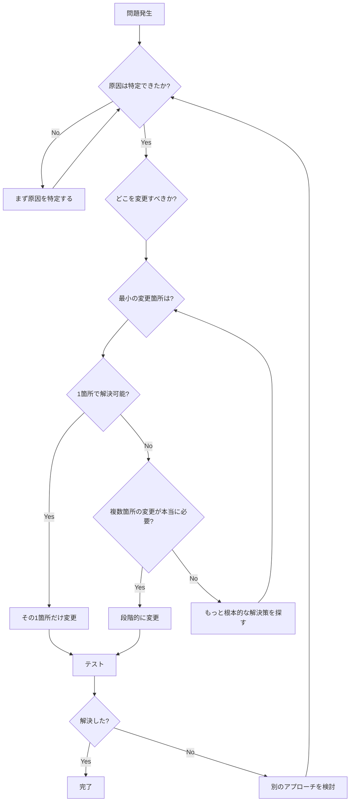
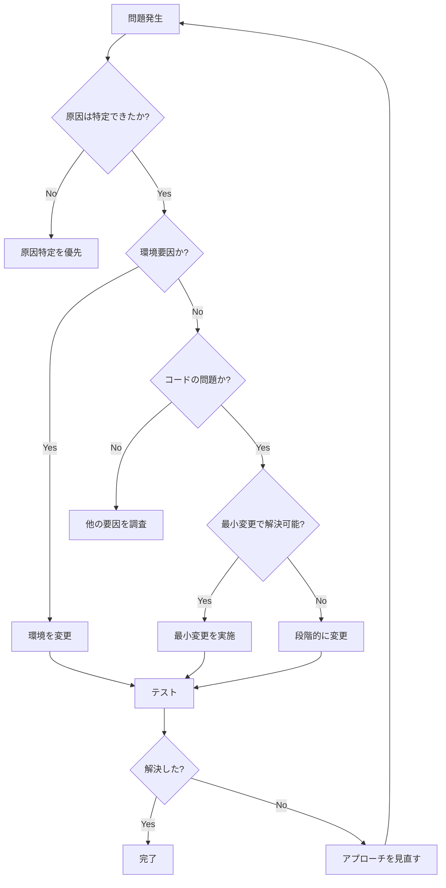

# コードリファクタリングの知恵：判断基準と思考プロセス

## 概要

このドキュメントは、order-1タスクでコードを大幅に変更してロールバックした経験から、**リファクタリングの判断基準**と**最小変更の原則**の重要性をまとめたものです。

---

## 1. リファクタリングの本質を理解する

### 1.1 「変更」には3つの種類がある

**1. バグ修正（Bug Fix）:**
- **目的**: 誤った動作を正す
- **判断**: 明確な誤りがある
- **リスク**: 低（正しい動作に近づく）

**2. リファクタリング（Refactoring）:**
- **目的**: 動作を変えずにコードの質を向上
- **判断**: 保守性・可読性の改善
- **リスク**: 中（慎重に行えば安全）

**3. 機能変更（Feature Change）:**
- **目的**: 新しい機能追加や動作変更
- **判断**: 要件・仕様に基づく
- **リスク**: 高（影響範囲が広い）

**思考のポイント：**

> 💡 **「動かない」からといって、すぐにコードを変更してはいけない**
> 
> まず「どの種類の変更が必要か」を見極める。
> 特に、環境固有の問題を**機能変更**で解決しようとすると、大きな失敗につながる。

---

### 1.2 今回の失敗：種類の見誤り

**実際に起きたこと：**

```
問題: Playwright MCPでダイアログが表示されない
  ↓
誤った判断: バグ修正が必要
  ↓
間違った対処: 機能変更（showDirectoryPicker → input要素）
  ↓
結果: 不要な変更 → ロールバック
```

**正しい理解：**

```
問題: Playwright MCPでダイアログが表示されない
  ↓
正しい判断: 環境固有の制約（コード変更不要）
  ↓
正しい対処: ツールの使い分け
  ↓
結果: コード変更なし → 時間節約
```

**教訓：**

> ⚠️ **問題の本質を見極めずに変更すると、不要なリファクタリングになる**
> 
> 「動かない」の原因が環境なら、コードではなく環境を変える。

---

## 2. 最小変更の原則

### 2.1 なぜ「最小変更」が重要か

**大規模変更のリスク：**

1. **デバッグが困難になる**
   - 何が原因で動かないか分からなくなる
   - 変更箇所が多いと、どこが悪いか特定できない

2. **テストコストが増大する**
   - すべての変更箇所をテストする必要
   - バグ混入のリスクが高まる

3. **ロールバックが大変**
   - 変更が広範囲だと元に戻すのも大変
   - 時間とコストの無駄

4. **コードレビューが難しい**
   - 変更が多すぎてレビューしきれない
   - 見落としが発生しやすい

**最小変更の利点：**

1. **問題の切り分けが容易**
   - 変更箇所が少ないので、原因特定しやすい

2. **テストが簡単**
   - 影響範囲が限定的

3. **ロールバックが容易**
   - すぐに元に戻せる

4. **レビューが簡単**
   - 変更の意図が明確

**思考のポイント：**

> 🎯 **「動かない」を「動く」に変える最短経路を探す**
> 
> 1行で解決できる問題に、100行の変更は不要。

---

### 2.2 最小変更の判断フローチャート



---

### 2.3 段階的変更の戦略

**悪い例（今回やってしまった）:**

```typescript
// ❌ 一気に全面書き換え
async selectFolder() {
  // showDirectoryPicker を完全に削除
  // input要素の実装を追加
  // 擬似ディレクトリハンドルを実装
  // イベントリスナーを追加
  // ... 100行以上の変更
}
```

**良い例（段階的アプローチ）:**

```typescript
// ✅ まず最小限の変更で検証
async selectFolder() {
  // Step 1: まず単純なフォールバック
  try {
    return await window.showDirectoryPicker();
  } catch (error) {
    // Step 2: エラー時のみ代替実装（最小限）
    return await this.fallbackFolderPicker();
  }
}

// Step 3: 動作確認後、必要なら fallbackFolderPicker を実装
```

**思考のステップ：**

1. **最小限の変更で仮説検証**
2. **動作確認**
3. **必要なら次の変更**
4. **不要なら終了**

---

## 3. 変更判断の思考プロセス

### 3.1 「変更すべきか？」の判断基準

**変更すべき状況：**

| 条件 | 理由 | 変更内容 |
|------|------|----------|
| ✅ コードに明確な誤りがある | バグを修正する必要 | バグ修正 |
| ✅ 全環境で同じ問題が発生 | 根本的な実装ミス | 実装修正 |
| ✅ テストが失敗している | 仕様を満たしていない | 機能修正 |
| ✅ 保守性が著しく悪い | 将来の変更が困難 | リファクタリング |

**変更すべきでない状況：**

| 条件 | 理由 | 対処法 |
|------|------|--------|
| ❌ 特定環境でのみ問題 | 環境固有の制約 | 環境を変える |
| ❌ 通常使用では動作する | 実装は正しい | ツールを使い分ける |
| ❌ 原因が不明 | 変更しても解決しない | まず原因特定 |
| ❌ ツールの仕様による | コードの問題ではない | ツールを理解する |

### 3.2 今回のケースの判断ミス

**状況:**
- Playwright MCPで動作しない
- 原因不明

**間違った判断:**
```
原因不明 → とりあえず実装を変更してみる ← ❌
```

**正しい判断:**
```
原因不明 → まず原因を特定する
  ↓
通常ブラウザで動作確認
  ↓
動作する → Playwright固有の問題
  ↓
コード変更不要 ← ✅
```

**教訓：**

> ⚠️ **「原因不明」のまま変更してはいけない**
> 
> 原因が分からないなら、変更しても解決しない。
> まず原因特定に時間をかける。

---

## 4. リファクタリングの経験的パターン

### 4.1 「動かない」問題の対処パターン

| 問題のパターン | 正しい対処 | 間違った対処 |
|---------------|-----------|-------------|
| **特定環境で動かない** | 環境を変える | コードを変える |
| **全環境で動かない** | コードを修正 | 環境のせいにする |
| **時々動かない** | 非同期処理を見直す | 再試行ロジックを追加 |
| **特定条件で動かない** | 条件分岐を修正 | 条件を回避する |

### 4.2 判断の優先順位

```
1. 原因を特定する ← 最優先！
   ↓
2. 最小の変更で解決できるか検討
   ↓
3. 影響範囲を評価
   ↓
4. テストで検証可能か確認
   ↓
5. 変更を実施
   ↓
6. テストで確認
   ↓
7. 問題が残れば、ステップ1に戻る
```

---

## 5. コードレビューの視点

### 5.1 変更の妥当性をチェックする

**自分でレビューする際の質問：**

1. **この変更は本当に必要か？**
   - 環境を変えれば解決しないか？
   - もっとシンプルな方法はないか？

2. **変更範囲は最小か？**
   - 1箇所で済む変更を複数箇所変えていないか？
   - 不要な変更が含まれていないか？

3. **テストで検証できるか？**
   - 変更後の動作を確認できるか？
   - 既存のテストが通るか？

4. **ロールバックは容易か？**
   - 問題があればすぐに戻せるか？
   - 変更が大きすぎないか？

5. **他の解決策はないか？**
   - コード以外の方法（設定、ツール、環境）で解決できないか？

**今回のケースでチェックしていたら：**

```
Q1: この変更は本当に必要か？
A: 通常ブラウザで動作確認していない → まず確認すべき

Q2: 変更範囲は最小か？
A: 100行以上の変更 → 大きすぎる

Q3: テストで検証できるか？
A: 環境依存の問題をテストで検証は困難

Q4: ロールバックは容易か？
A: 大規模な変更なので大変

Q5: 他の解決策はないか？
A: ツールを変えれば解決するかも → 試すべき
```

**結論:**
→ この変更は実施すべきでなかった

---

### 5.2 レビューのチェックリスト

**変更前:**
- [ ] 原因は特定できているか？
- [ ] この変更で解決することが確実か？
- [ ] 最小の変更か？
- [ ] 他の解決策を検討したか？

**変更後:**
- [ ] テストは通るか？
- [ ] 既存機能に影響はないか？
- [ ] ドキュメントの更新は必要か？
- [ ] ロールバック手順は明確か？

---

## 6. ケーススタディ：order-1タスクのリファクタリング失敗

### 6.1 何が起きたか

**タイムライン:**

```
15:00 Playwright MCPで動作しないことを確認
15:05 showDirectoryPicker に問題があると判断 ← ❌ 早計
15:10 input要素方式への書き換え開始 ← ❌ 大規模変更
15:30 複雑な実装を追加
15:45 テスト修正
16:00 Chrome DevTools MCPで動作確認
16:05 元のコードで動作することが判明 ← 😭
16:15 全ての変更をロールバック
17:00 ロールバック完了

合計: 2時間のロス
```

### 6.2 何が間違っていたか

**判断の誤り:**

1. **原因特定が不十分**
   - 通常ブラウザで確認していない
   - Playwright固有の問題という仮説を検証していない

2. **最小変更の原則を無視**
   - いきなり全面書き換えに着手
   - 段階的アプローチを取らなかった

3. **環境要因を軽視**
   - コードの問題と決めつけた
   - ツールの特性を理解していなかった

### 6.3 正しいアプローチだったら

**あるべきタイムライン:**

```
15:00 Playwright MCPで動作しないことを確認
15:05 通常のChromeで動作確認 ← ✅ まずこれ！
15:10 動作する → Playwright固有の問題と特定
15:15 Playwrightのドキュメント確認
15:20 Chrome DevTools MCPで動作確認
15:25 コード変更不要と判断 ← ✅

合計: 25分で完了
```

**時間の差:**
- 間違ったアプローチ: 2時間
- 正しいアプローチ: 25分
- **約5倍の効率差！**

### 6.4 得られた教訓

**Do（すべきこと）:**
- ✅ 原因特定を最優先
- ✅ 最小変更の原則を守る
- ✅ 環境要因を疑う
- ✅ 段階的にアプローチ

**Don't（すべきでないこと）:**
- ❌ 原因不明のまま変更
- ❌ 大規模な書き換え
- ❌ 環境を無視してコード変更
- ❌ 一気に全面書き換え

---

## 7. リファクタリングの賢者の心得

### 7つの原則

1. **原因特定が先、変更は後**
   - 「なぜ動かないか」が分からないうちは変更しない

2. **最小変更の原則**
   - 1行で解決できるなら1行だけ変更

3. **段階的アプローチ**
   - 一気に書き換えず、少しずつ検証

4. **環境要因を疑う**
   - コードが正しく見えるなら、環境を疑う

5. **ロールバック可能性を保つ**
   - いつでも元に戻せる状態を維持

6. **テストで検証**
   - 変更のたびにテストを実行

7. **振り返りを忘れずに**
   - 失敗から学び、次に活かす

---

## 8. 実践的な判断フローチャート

### 8.1 「変更すべきか」の意思決定ツリー



### 8.2 チェックリスト

**変更前の確認:**
- [ ] 原因は特定できているか？
- [ ] 複数の環境で確認したか？
- [ ] ドキュメント・GitHubを確認したか？
- [ ] 最小の変更で解決できるか？
- [ ] テストで検証可能か？

**変更中の確認:**
- [ ] 変更範囲は最小限か？
- [ ] 段階的にアプローチしているか？
- [ ] 各段階でテストしているか？

**変更後の確認:**
- [ ] すべてのテストが通るか？
- [ ] 既存機能に影響はないか？
- [ ] ロールバック可能か？

---

## 9. まとめ：コードを変えるべきか、環境を変えるべきか

### 判断マトリックス

| 状況 | コード変更 | 環境変更 | 優先度 |
|------|----------|---------|--------|
| 全環境で動かない | ✅ | ❌ | コード |
| 特定環境のみ動かない | ❌ | ✅ | 環境 |
| コードに明確な誤り | ✅ | ❌ | コード |
| ツールの仕様による | ❌ | ✅ | 環境 |
| 原因不明 | ❌ | ❌ | 原因特定 |

### 今回の教訓

> 🎓 **「動かない」≠「コードを変える」**
> 
> まず原因を特定し、環境で解決できないか検討してから、コード変更を判断する。

---

## 10. 参考資料

### 書籍
- 『リファクタリング』 Martin Fowler
- 『レガシーコード改善ガイド』 Michael Feathers

### 記事
- [The Boy Scout Rule](https://www.oreilly.com/library/view/97-things-every/9780596809515/ch08.html)
- [YAGNI - You Aren't Gonna Need It](https://martinfowler.com/bliki/Yagni.html)

---

**作成日**: 2025年11月6日  
**元タスク**: order-1.md  
**関連ドキュメント**: 
- `docs/reflectors/order-1-reflect.md`
- `docs/guidelines/code-refactoring-principles.md`
- `docs/wisdom/debugging-wisdom.md`
